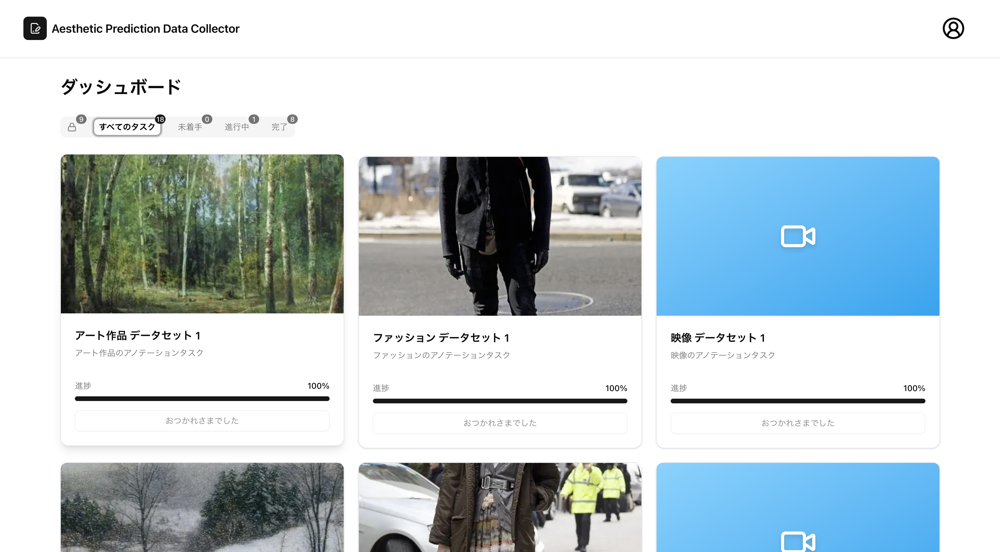
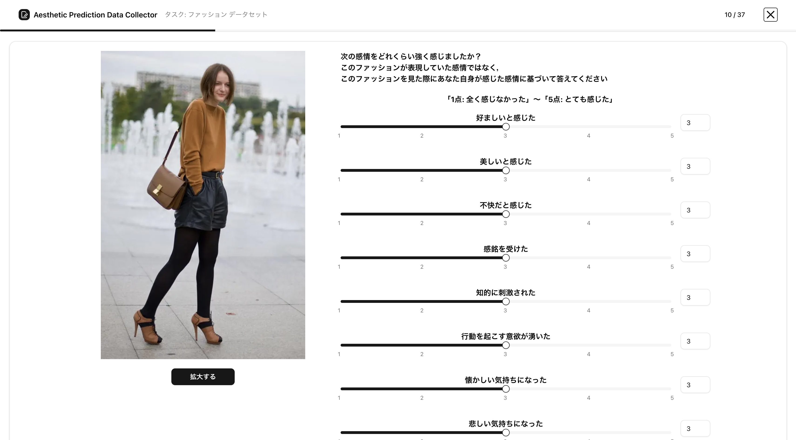
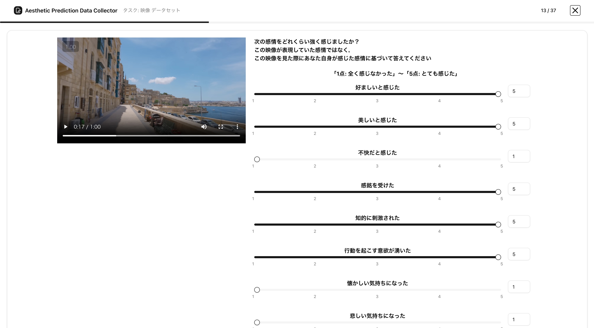

[](./LICENSE) [](./PRIVACY.md) [](./PRIVACY.JA.md)

**[English](#english)** | **[日本語](#日本語)**

> [!NOTE]
> **Deployment is currently suspended.** The previously available demo at `aesthetic-prediction-data-collector.vercel.app` is no longer accessible. Please run it locally if you want to try the app.
>
> **現在デプロイは停止しています.** 以前公開していた `aesthetic-prediction-data-collector.vercel.app` のデモは利用できません. 試したい場合はローカルで起動してください.

---

## English

### Overview

This web application was developed for the **data collection phase (Section 2)** of the following study:

> Hayashi T., Takahara H., Mawalim C. O., Narimatsu H., Kumano S., Okada S.
> *"Cross-Domain Personalized Aesthetic Assessment: Data Collection and Analysis"*
> HCG Symposium 2025.

The study constructs a dataset that captures the **aesthetic preferences of the same individuals across three domains** — artworks, fashion, and landscape — to investigate the consistency and transferability of personalized aesthetic preferences across domains.

### What this app does

The application served as the annotation platform for the data collection. Each rater was assigned one annotation set and asked, for every stimulus, to report:

- **Overall aesthetic judgment** on a 7-point scale (1 = not aesthetic at all, 7 = extremely aesthetic)
- **Nine aesthetic emotions** on a 5-point scale, based on **AESTHEMOS** (Schindler et al., 2017):
  *Liked it, Found it beautiful, Found it distasteful, Was impressed, Challenged intellectually, Motivated to act, Felt nostalgic, Made me sad, Amused me*

Stimuli from the three domains were **interleaved** (not presented in long single-domain blocks) so that raters maintained a consistent aesthetic standard across domains.

### Data collection results

| Item | Value |
| --- | --- |
| Raters | 142 Japanese speakers |
| Total samples | 6,528 |
| Artwork images | 2,345 (from LAPIS) |
| Fashion images | 2,083 (from Clothing Co-Parsing) |
| Landscape videos | 2,100 (from Sekai-Real-Walking-HQ, 101 countries) |
| User–item interactions | ~98,000 |
| Collection period | Within 1 month |

Each rater also provided demographic information (age, gender, nationality, education), Big Five personality traits, and interest level for each domain.

### Screenshots

#### Dashboard


#### Annotation pages
Image annotation:


Video annotation:


### Tech stack

- **Framework:** Next.js 15 (App Router) + React 19 + TypeScript
- **Backend:** Supabase (Auth + DB), Vercel Blob (media storage)
- **UI:** Tailwind CSS v4, Radix UI, shadcn/ui
- **i18n:** next-intl
- **Email:** Resend

### Local setup

```bash
bun install
bun run dev
```

Environment variables for Supabase, Vercel Blob, and Resend are required. See the source for details.

### License

[MIT](./LICENSE)

---

## 日本語

### 概要

このWebアプリケーションは, 以下の研究の **データ収集フェーズ (2章)** のために開発されました.

> 林貴斗, 高原大明, Mawalim C. O., 成松宏美, 熊野史朗, 岡田将吾.
> 「ドメインを横断したパーソナライズ美的評価のためのデータ収集と分析」
> HCGシンポジウム 2025.

本研究は, **同一個人の美的嗜好を美術作品・ファッション・風景の3ドメインにわたって収集** し, ドメインを跨いだ美的嗜好の一貫性と転移可能性を分析するためのデータセットを構築するものです.

### このアプリの役割

データ収集におけるアノテーションプラットフォームとして機能しました. 各評定者は割り当てられた1セットを評価し, 各サンプルに対して以下を報告しました.

- **総合的な美的判断** を 7件法 (1 = 全く美的でない, 7 = 非常に美的) で評価
- **9種類の美的感情** を 5件法で評価. 項目は **AESTHEMOS** (Schindler et al., 2017) に基づく:
  *好ましい / 美しい / 不快 / 感銘 / 知的刺激 / 動機づけ / 懐かしい / 悲しい / 面白い*

3ドメインの刺激は単一ドメインを連続提示するのではなく **交互に提示** することで, ドメイン間で一貫した美的判断基準を促しました.

### データ収集結果

| 項目 | 値 |
| --- | --- |
| 評定者 | 日本語話者 142名 |
| 総サンプル数 | 6,528 |
| 美術作品画像 | 2,345枚 (LAPIS より) |
| ファッション画像 | 2,083枚 (Clothing Co-Parsing より) |
| 風景動画 | 2,100本 (Sekai-Real-Walking-HQ, 101カ国) |
| ユーザ–アイテム相互作用 | 約 98,000 件 |
| 収集期間 | 1ヶ月以内 |

評定者からは人口統計情報 (年齢, 性別, 国籍, 学歴), Big Five 性格特性, 各ドメインへの興味も収集しました.

### スクリーンショット

#### ダッシュボード


#### アノテーション画面
画像アノテーション:


動画アノテーション:


### 技術スタック

- **フレームワーク:** Next.js 15 (App Router) + React 19 + TypeScript
- **バックエンド:** Supabase (認証 + DB), Vercel Blob (メディア保存)
- **UI:** Tailwind CSS v4, Radix UI, shadcn/ui
- **多言語対応:** next-intl
- **メール:** Resend

### ローカル起動

```bash
bun install
bun run dev
```

Supabase, Vercel Blob, Resend の環境変数が必要です. 詳細はソースを参照してください.

### ライセンス

[MIT](./LICENSE)
